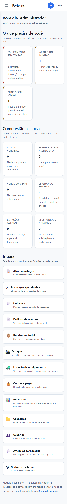
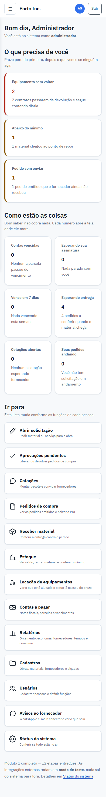
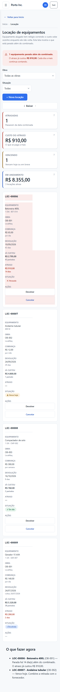
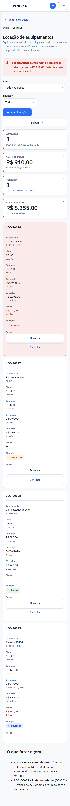
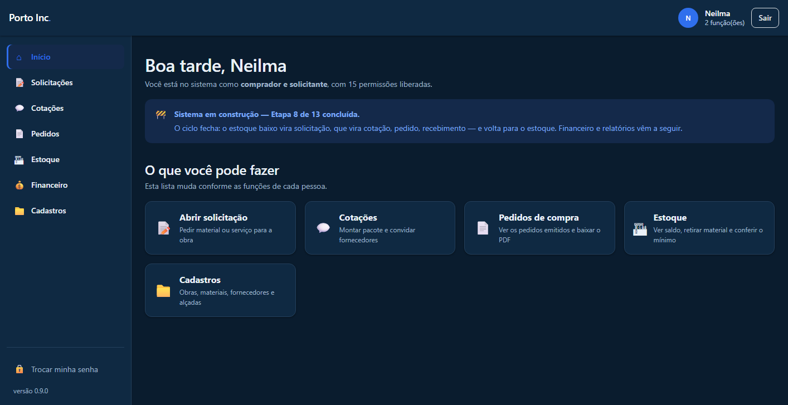
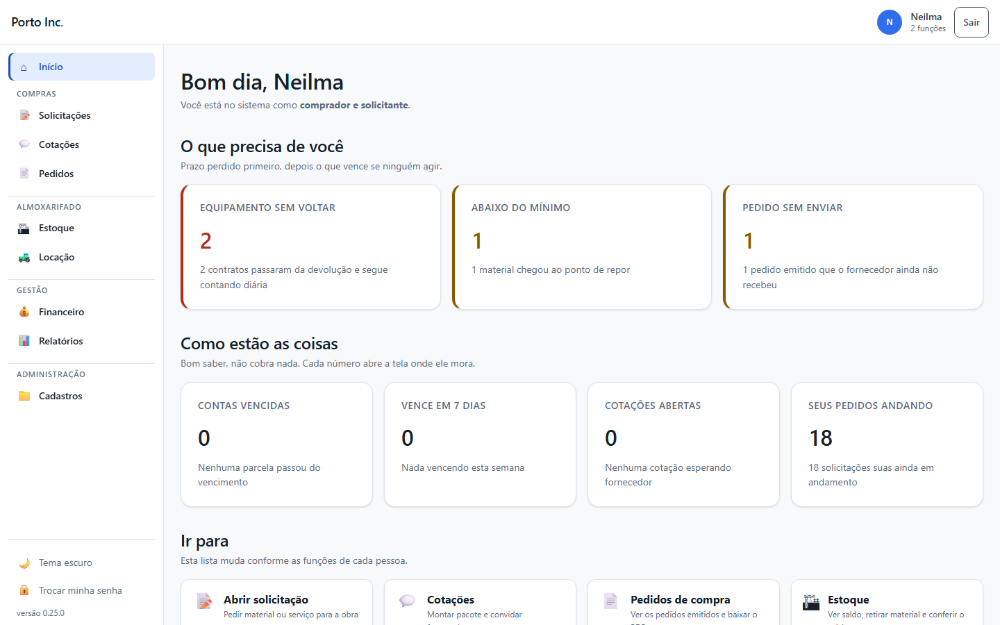
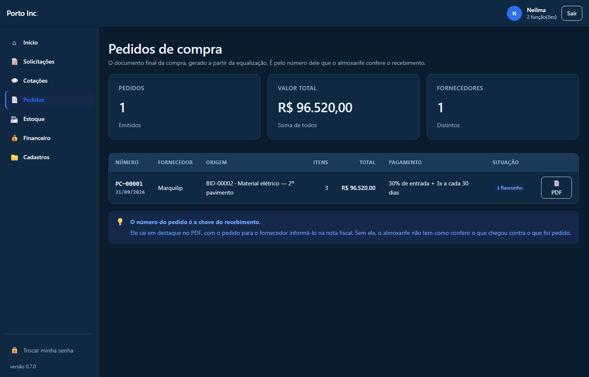
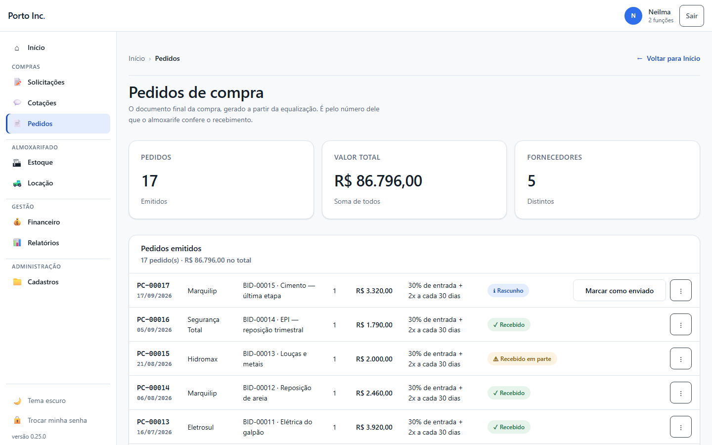
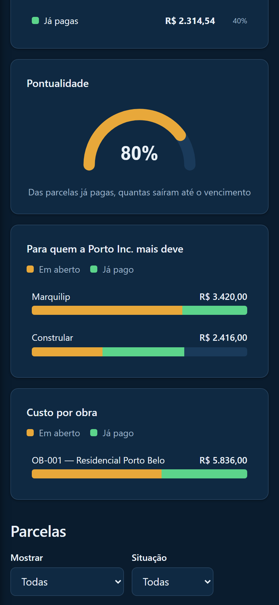
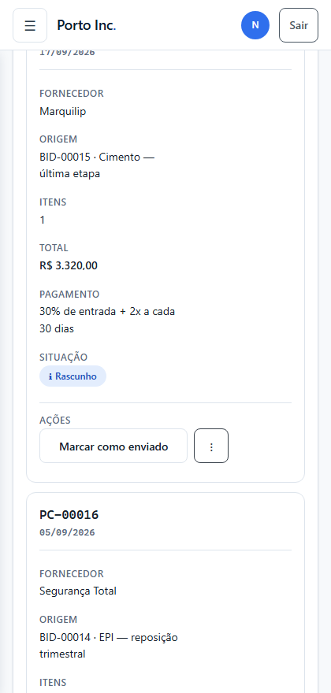

<!-- versao: 0.34.0 -->

# Design do sistema — Porto Inc.

> Este documento é para quem **mexe** no sistema, não para quem o usa.
> Quem usa tem o `Tutorial-PortoInc.pdf`.
>
> Aqui ficam as decisões visuais e o porquê de cada uma: escalas, cores, anatomia das
> peças, e o registro do que mudou em cada etapa. O tutorial recebe o que a pessoa
> **faz**; este documento recebe o que o sistema **é**.

---

# Parte 1 — O padrão

## 1.1 De onde ele veio

Quatro telas de painel foram dadas como referência, em tema claro e escuro. Delas foi
tirada a **linguagem visual**, não o conteúdo — a referência é um painel de gestão de
projetos; este é um sistema de compras e almoxarifado. Copiar a disposição daria telas
bonitas que não batem com o trabalho.

O que foi aproveitado:

1. **Anatomia igual em todo cartão** — título à esquerda, ação à direita, corpo embaixo
2. **KPI é número grande com gráfico pequeno ao lado**, não número solto
3. **Muito respiro** — canto arredondado, borda suave, fundo do cartão quase da cor da página
4. **Cor com significado**, não decoração
5. **Lista dentro de cartão** — ícone, duas linhas de texto, números alinhados à direita
6. **No celular** os cartões viram largura cheia e as ações sobem para o topo

O que foi **recusado**, e por quê:

| O que | Por que não |
|---|---|
| Menu "⋮" em todo cartão | Na maioria não faria nada. Menu vazio é ruído |
| O contraste baixo do texto secundário no escuro | Nas referências ele está no limite da leitura. A regra de contraste do sistema continua valendo |
| O layout literal | É outro domínio. A forma se copia, a disposição não |

## 1.2 Cor

Toda cor sai de `frontend/src/estilos/tokens.css`. **Nenhuma tela escreve cor solta** — o
conferidor de padrão acusa quem escrever.

Os tokens são divididos em três camadas:

- **Marca** — `--marinho-*`, `--azul-*`. Não mudam com o tema
- **Neutros** — `--neutro-0` a `--neutro-900`. A matéria-prima
- **Papéis** — `--fundo`, `--texto`, `--borda`, `--menu-*`. **São estes que trocam com o tema**

Uma tela que usa papéis funciona nos dois temas sem saber que eles existem. Uma tela que
usa neutros direto quebra no escuro.

### Cor nunca informa sozinha

Verde, amarelo e vermelho sempre vêm acompanhados de ícone ou texto. Cerca de 8% dos
homens não distingue verde de vermelho; para eles um selo colorido sem palavra não diz
nada.

Para texto sobre fundo colorido existe um token separado (`--sucesso-texto`,
`--erro-texto`...), mais escuro no tema claro e mais claro no escuro. A cor cheia serve
para botão e borda; para texto pequeno ela não alcança o contraste mínimo de 4,5:1.

## 1.3 Espaçamento

Escala de 4px. **Só ela.**

| Token | Valor | Onde se usa |
|---|---|---|
| `--esp-1` | 4px | Entre rótulo e campo |
| `--esp-2` | 8px | Entre itens de uma mesma linha |
| `--esp-3` | 12px | Dentro de um item |
| `--esp-4` | 16px | Dentro do cartão |
| `--esp-5` | 24px | Entre cartões |
| `--esp-6` | 32px | Entre seções |
| `--esp-7` | 48px | Respiro grande |
| `--esp-8` | 64px | Separação de bloco |

O que a escala resolve é **proximidade**: o que é do mesmo assunto fica mais perto do que
o que não é. Valor solto é o que faz uma tela respirar diferente da outra sem ninguém
saber explicar por quê.

## 1.4 Tipografia

**A letra: IBM Plex Sans.**

Até a Revisão 1 a fonte era `Segoe UI, system-ui` — ou seja, a que vem de graça no
Windows. Nunca foi escolhida; foi herdada.

Plex Sans foi desenhada para contexto técnico: numeral claro, `1`/`l`/`I` que não se
confundem, altura-x grande. Este sistema é lido de relance e muito em número — R$,
quantidade, prazo — e no celular do Gilson dentro da obra, com sol na tela.

| | |
|---|---|
| Arquivo | `frontend/public/fontes/plex-sans-latin.woff2` |
| Peso | 45 KB, uma requisição |
| Subconjunto | `latin` — cobre todo o português (ç, ã, õ, ê) |
| Variável | 400 a 700 num arquivo só |
| Hospedagem | nossa. Obra tem sinal ruim; nada de servidor de terceiro |

`font-display: swap`: o texto aparece na hora com a fonte do sistema e troca quando a
nossa chega. Ninguém olha para tela em branco.

A pilha de reserva (`'Segoe UI', system-ui, -apple-system, sans-serif`) continua lá para
o caso de o arquivo não carregar.

| Token | Valor | Para quê |
|---|---|---|
| `--txt-xs` | 12px | Rótulo de coluna, legenda |
| `--txt-sm` | 14px | Texto de tabela, item de menu |
| `--txt-md` | 16px | Texto corrido |
| `--txt-lg` | 18px | Subtítulo |
| `--txt-xl` | 24px | Título de seção |
| `--txt-2xl` | 32px | Título de tela |
| `--txt-3xl` | 40px | Número grande de KPI |

Altura de linha: `--linha-apertada` (1,25) para título, `--linha-normal` (1,55) para
texto, `--linha-solta` (1,7) para leitura longa. Título com entrelinha de texto parece
solto; texto com entrelinha de título cansa.

**Largura de leitura:** `--largura-leitura`, 70 caracteres. Linha mais longa faz o olho
perder a volta ao trocar de linha.

**Regras de hierarquia:**

- Um `<h1>` por tela, sempre. É por ele que o leitor de tela anuncia onde a pessoa chegou
- Nunca pular nível — de `h1` para `h3` deixa buraco na estrutura
- **Nenhuma maiúscula de estilo.** Quem marca um rótulo é o **peso** e a **cor**, não a
  caixa. Até a Revisão 1 havia seis lugares com `text-transform: uppercase` — cabeçalho
  de tabela, rótulo de indicador, grupo do menu. Saíram todos, por dois motivos: é o
  quinto sinal de "página gerada por IA" na lista da skill `frontend-design`, e custa
  largura — "EQUIPAMENTO SEM VOLTAR" ocupa ~15% a mais que "Equipamento sem voltar", e
  num iPhone de 393px isso era uma linha inteira a mais por cartão

**Números:** dígitos de largura fixa (`font-variant-numeric: tabular-nums`) em tabela e
em KPI. Sem isso a coluna dança a cada atualização.

## 1.5 Alinhamento

- Número à **direita**, texto à **esquerda**. Sempre, sem exceção
- Rótulo e campo no mesmo eixo vertical
- Cartões da mesma fileira alinhados pelo **topo**, não pelo centro — centralizados, uma
  descrição de duas linhas empurra o título para fora da linha dos vizinhos

## 1.6 Alvo e foco

- **44px** de altura mínima para qualquer coisa que se toca com o dedo
- No computador, item de menu pode ter 40px: ali o alvo é o ponteiro. No celular volta a 44
- Contorno de foco visível em **tudo** que recebe teclado. Nunca remover sem pôr algo no lugar

## 1.7 Os dois temas

**O claro é o padrão. O escuro é escolha**, feita no botão do rodapé do menu e lembrada
pelo navegador.

Antes o sistema seguia a preferência do Windows: quem tinha o computador no escuro
recebia o sistema escuro sem nunca ter pedido, e sem ter como voltar.

Detalhes que importam:

- O tema entra **antes de a página desenhar**, por um script no `index.html`. Sem isso a
  página pinta clara e só depois vira escura — um flash branco a cada carregamento
- O claro é a **ausência** de marca no HTML; só o escuro marca. Um estado a menos para
  manter sincronizado
- A barra do navegador no celular (`theme-color`) acompanha
- Armazenamento bloqueado (janela anônima, política da empresa) não quebra nada: abre no claro

### A moldura de navegação acompanha o tema

A barra do topo e o menu lateral usam os mesmos tokens (`--menu-*`) e trocam juntos.

Os tons deles **não são** os mesmos do conteúdo: uma navegação que se confunde com a área
de trabalho faz a pessoa perder a referência de onde está. No claro a moldura é mais clara
que o conteúdo; no escuro, mais escura.

O cinza do texto secundário é **diferente em cada tema**. Sobre fundo quase preto, o cinza
que funciona no claro vira mancha ilegível.

## 1.8 Hierarquia de botão

| Tipo | Quando |
|---|---|
| **Principal** | **Um por tela.** A ação que a pessoa veio fazer |
| Secundário | Ações de apoio |
| Discreto | Ação de linha de tabela, ação de baixo risco |

Quando o olho vê três botões "principais", nenhum é principal.

## 1.9 Modal

**Modal serve para interromper. Se não há motivo para interromper, ele atrapalha.**

**Entra em:**

- Confirmação de coisa irreversível — cancelar nota, cancelar locação, devolver
  equipamento, reprovar solicitação, remover arquivo
- Formulário **curto**, até uns 6 campos
- Download de relatório, onde há escolha real (obra, período, o que incluir)

**Não entra em:**

- Formulário longo com lista de itens — no celular vira caixa dentro de caixa, com duas
  barras de rolagem
- Qualquer coisa que precise de endereço próprio. Modal não tem link
- Download simples de tabela, com duas opções. O menu suspenso basta
- **Modal dentro de modal: nunca.** Se precisou, o fluxo está errado e é o fluxo que se conserta

**O contrato** — é a peça que mais se faz errado:

- `<dialog>` nativo, não uma `div` fingindo ser janela
- O foco **entra** ao abrir e **volta para o botão** que o abriu ao fechar
- Foco preso dentro enquanto está aberto
- **Esc** fecha; com campo preenchido e não salvo, pergunta antes
- O fundo não rola atrás
- No celular ocupa a tela inteira

## 1.10 Ícone

Todo ícone do sistema vem de `frontend/src/componentes/Icone.tsx`: 33 traçados em
24×24, `fill: none`, `stroke: currentColor`, traço 1,7. Um arquivo, sem dependência.

```tsx
<Icone nome="alerta" />
<Icone nome="pasta" className="menu__icone" />
```

**Por que não emoji.** Até a Revisão 1 havia **105 emojis** fazendo papel de ícone em 32
arquivos. Quatro problemas, todos medidos:

| | |
|---|---|
| Desenho | 📁 no Windows não é o mesmo do iPhone nem do Android |
| Cor e peso | não obedecem; fica colorido no meio de texto cinza, some em botão escuro |
| Leitor de tela | anuncia "emoji de pasta de arquivos" no meio da frase |
| Alinhamento | não senta na linha de base do texto |

**Tamanho em `em`**, não em pixel: o ícone acompanha a letra ao lado dele. Por isso as
classes que já diziam `font-size` continuam mandando no tamanho.

**O ícone é sempre decorativo** (`aria-hidden`). Quem carrega o significado é o texto ao
lado. Ícone sozinho num botão exige `aria-label` **no botão**.

## 1.11 Hierarquia de borda e sombra

**Borda contém. Sombra levanta.**

Até a Revisão 1 todo cartão tinha a mesma sombra macia. Sombra que aparece em tudo não
informa nada — vira textura. É o quarto sinal da lista da skill: *"content chopped into
identical rounded cards, the same soft grey shadow under each"*.

- **Cartão parado:** só borda. Ele guarda conteúdo.
- **Cartão que se clica:** ganha sombra ao passar o mouse **e ao receber foco de
  teclado** — quando ele de fato se oferece.

## 1.12 O pente-fino

```
cd scripts
npm run pente-fino
```

Acha **classe** de defeito lendo o CSS e o TSX, em **0,14 segundo, sem navegador**.

Nasceu de uma reclamação justa do cliente: o que deixava o trabalho lento nunca foi a
régua de telas — era rodá-la como **laço** de correção, dezenas de vezes por etapa, 25s
cada. E o defeito que motivou o script (`.celula-texto { max-width }` prendendo a célula
dentro do modo cartão) foi achado **lendo CSS**, não medindo.

A divisão de trabalho que ficou:

| Ferramenta | O que faz | Custo |
|---|---|---|
| `pente-fino` | acha classe de defeito, lendo | 0,14s |
| `padrao` | as 7 regras do padrão, lendo | ~0s |
| `auditoria-ui` | confirma **uma vez**, no fim | ~25s por largura |

O navegador serve para **ver**, não para acusar.

**As regras de hoje:**

| Regra | O que cobra |
|---|---|
| `CELULA_PRESA_NO_CARTAO` | teto de largura em célula sem escapar do modo cartão |
| `COR_DE_LINHA_SEM_MODO_CARTAO` | `.linha-x > *` pintando célula sem repintar o cartão |
| `ESCONDER_TABELA_PELA_CLASSE` | `<table>` com a classe de esconder — não obedece `width: 1px` |
| `GRADE_DE_COLUNA_FIXA` | `repeat(N, ...)` que não cede |
| `ROTULO_EM_MAIUSCULA` | `text-transform: uppercase` |
| `EMOJI_COMO_ICONE` | emoji fazendo papel de ícone |

## 1.13 O conferidor de padrão

```
cd scripts
npm run padrao
```

Lê o código-fonte e acusa o que foge do combinado. É o que faz o padrão durar depois que
esta fase acabar.

**A dívida conhecida.** O sistema foi construído antes do padrão existir, então já nasce
com violações. Um conferidor que reprova desde o primeiro dia é um conferidor que todo
mundo aprende a ignorar. Por isso ele compara com `scripts/padrao-divida.json`: **reprova
quando um número sobe**, e avisa quando cai. A dívida encolhe a cada etapa.

**Exceção declarada.** Quando uma regra não se aplica, o próprio arquivo diz por quê:

```
// padrao-ignora: sem-titulo — é conteúdo de aba; o <h1> é do invólucro
```

Sem essa saída a ferramenta obrigaria a inventar um título errado só para calar a boca —
que é como um conferidor piora o sistema em vez de melhorar.

---

# Parte 2 — O diário das etapas

## Design 0 — Fundação

**O que entrou**

| | |
|---|---|
| Tema | O claro virou o padrão de verdade. O escuro deixou de ser automático e virou escolha, com botão no rodapé do menu e memória no navegador |
| Moldura de navegação | Barra do topo e menu lateral passaram a usar os mesmos tokens e a trocar com o tema |
| Escalas | `--esp-8`, `--txt-3xl`, `--raio-xl`, alturas de linha e largura de leitura |
| Padrão | Este documento |
| Conferidor | `npm run padrao`, com a dívida atual registrada como linha de base |

**Duas coisas que só apareceram ao abrir o código**

1. **A barra lateral já acompanhava o tema.** Quem estava preso no azul-marinho era a
   barra do **topo**. A impressão de que a lateral era fixa vinha de o sistema seguir o
   Windows: com o computador no escuro, tudo ficava escuro. As duas passaram a usar os
   mesmos tokens de qualquer forma — para quem usa, elas são a mesma moldura.

2. **Os atalhos da tela de Início estavam desalinhados.** Numa mesma fileira, o título de
   um cartão ficava 9px abaixo do vizinho. A causa era `align-items: center`: com uma
   descrição de uma linha e outra de duas, os títulos paravam em alturas diferentes.
   Alinhados pelo topo, a fileira inteira volta à mesma linha.

**A dívida registrada**

| Regra | Dívida |
|---|---|
| Telas com mais de um botão principal | 13 |
| Cartões escritos à mão | 29 |
| Dinheiro ou data formatados fora das funções oficiais | 5 |
| Telas de lista sem os três estados | 5 |
| Cor escrita direto no CSS | 2 |
| Espaçamento em px fora da escala | 4 |
| Telas sem título | 0 |

Cada etapa seguinte derruba parte disso. O Design 2 (peças) zera as duas maiores.

**Conferido**

- Abre no claro mesmo com o Windows no escuro
- O botão troca, e a escolha sobrevive ao recarregamento
- 60 provas de tela verdes
- Alinhamento medido nas duas larguras, sem achados

## Design 1 — Cabeçalho e navegação

**A situação antes.** Das 34 telas, 9 mostravam onde a pessoa estava e 2 tinham algum
"Voltar" — e nessas duas ele ficava no rodapé do formulário, não no topo. Nas outras 25,
quem entrava só saía pelo menu ou pelo botão do navegador.

**A estrutura**, agora igual em 30 telas:

```
Início › Cotações › Pacote de cotação        ← Voltar para Cotações
────────────────────────────────────────────────────────────────────
Pacote de cotação BID-00002   [Em aberto]         [Baixar] [Convidar]
Material elétrico — 2º pavimento
```

### Três decisões, e o porquê

**O Voltar leva à tela-mãe, não à anterior.** Voltar "para a anterior" parece igual mas
não é: se a pessoa chegou por outro caminho, ou acabou de salvar um formulário, o botão a
joga num lugar inesperado ou numa tela desatualizada. A tela-mãe é sempre o mesmo lugar.

**O rótulo diz o destino** — "Voltar para Cotações", não uma seta solta. Quem usa leitor
de tela ouve para onde vai; quem enxerga também.

**O último degrau da migalha não é link.** É onde a pessoa está. Link que não leva a lugar
nenhum engana quem navega por teclado: aperta Enter e nada acontece.

### Onde a hierarquia mora

Em `navegacao.ts`, junto da lista que monta o menu. Mesmo motivo de antes: quando menu e
migalhas liam listas separadas, elas divergiram e a tela de Início passou meses anunciando
coisa que não era mais verdade.

Os coringas da rota são trocados pelos valores do endereço atual — numa equalização, o
Voltar leva **àquela** cotação, não à lista.

### As quatro telas de fora

Cada uma com o motivo escrito no próprio arquivo:

| Tela | Por quê |
|---|---|
| Entrar | Não há sistema atrás dela para onde voltar |
| Portal do fornecedor | É de quem não tem conta nem menu no sistema |
| Abas de WhatsApp e E-mail | O cabeçalho é do invólucro; dois títulos na mesma tela quebram a hierarquia |

### Virou medição

O conferidor ganhou a regra **"telas sem o cabeçalho padrão"**. Tela nova sem Voltar
reprova. "Voltar em todas as páginas" deixou de ser promessa e virou fato conferido.

### Três erros do script de conversão

Trinta telas convertidas por script, e ele errou três vezes. Vale registrar porque são
erros que qualquer conversão em massa comete:

1. **Apagou a descrição de 27 das 30 telas.** O padrão de busca exigia que a descrição
   fosse o fim do bloco, e o bloco termina noutra tag. A pasta das telas foi devolvida ao
   marco anterior e o trabalho refeito.
2. **Jogou fora os selos de situação** de 5 telas de detalhe. Apareceu porque o compilador
   passou a acusar `Selo` importado e não usado — import sobrando é sintoma, não sujeira.
   O cabeçalho ganhou um lugar próprio para eles, porque "SOL-00018, aguardando aprovação"
   é uma coisa só.
3. **Transformou um título em texto literal.** Apareceria com as chaves na tela.

**A lição:** conversão em massa precisa de conferência do RESULTADO, não só do compilador.
Os três passaram pela compilação; dois só apareceram ao olhar a tela e o aviso de import.

### Conferido

- 769 provas verdes (355 unidade, 325 integração, 89 tela)
- Alinhamento sem achados em 1440px e 420px
- Conferidor aprovado, com a regra do cabeçalho em ok

## Design 2 — As peças

### A seta do campo de escolha (D1 da lista)

Estava com `appearance: auto`: quem desenhava era o navegador, e ele a punha onde queria
— medido, 34px para dentro da borda direita num campo de 212px. E ela não trocava de cor
com o tema.

Agora é desenho nosso, embutido no CSS, a 12px da borda e na cor do texto secundário, com
versão própria para o tema escuro. Conferido nos dois, ampliado.

### Cartão e indicador, dois nomes para duas coisas

O que se chamava `Cartao` era um **indicador**: rótulo, número e uma linha de contexto,
usado em 36 lugares. O nome passou a ser `Indicador`.

`Cartao` ficou sendo a **caixa** que embrulha qualquer conteúdo, com anatomia única:
cabeçalho com título e ações em cima, corpo embaixo. Um número solto dentro de uma caixa
não é a mesma coisa que a caixa, e chamar os dois de cartão obrigava a decidir, em cada
tela, de qual dos dois se estava falando.

O canto ficou mais arredondado (`--raio-xl`), que é o que dá o ar mais leve da referência.

### Modal

É um `<dialog>` de verdade. O navegador já dá o foco preso, o bloqueio do que está atrás,
o Esc e o fundo escurecido — reimplementar isso à mão é de onde vem a maioria dos modais
quebrados.

O que o navegador não faz, e está no componente: devolver o foco ao botão que abriu,
travar a rolagem de trás, e perguntar antes de descartar o que foi preenchido.

**Primeiro uso:** cancelar nota fiscal, que até então executava **na hora, sem perguntar**.

**Sobre as provas.** O navegador de mentira dos testes (jsdom) não implementa `<dialog>`.
Há um substituto mínimo no preparo dos testes, e está escrito lá o que ele prova (a lógica
do componente) e o que não prova (o que é do navegador). As partes do navegador foram
conferidas num navegador de verdade: 9 de 9.

### O menu "⋮" — e por que ele mudou de status

Na Parte 1 está escrito que o menu "⋮" das telas de referência **não** seria copiado:
na maioria dos cartões ele não faria nada, e menu vazio é ruído. Isso continua valendo.

Só que aqui ele ganhou trabalho de verdade, e a necessidade **apareceu medindo**:

1. A linha da tabela de Pedidos tinha até quatro botões
2. Com o texto podendo quebrar, a coluna ficava serrilhada — foi o **D2** da lista
3. Impedindo a quebra, os últimos botões saíam da tela — troquei um defeito por outro
4. A saída não era espremer, era **escolher**: a ação que faz o pedido andar fica à vista,
   e o apoio entra no menu

Resultado medido: a tabela passou a caber inteira, e as colunas de texto ganharam espaço
— "Origem" saiu de quatro linhas para duas.

### A dívida caiu

| Regra | Antes | Agora |
|---|---|---|
| Cartões escritos à mão | 29 arquivos | **21** |
| Telas sem cabeçalho padrão | 25 | **0** |

### Duplicação achada no caminho

`.migalhas` estava definida em **dois** arquivos de estilo — a nova em `painel.css` e a
antiga em `cadastros.css`, que carrega depois e vencia em silêncio. É exatamente o que o
conferidor de padrão existe para evitar. A antiga saiu.

### A régua estava cega no celular

Ao juntar as duas medições numa volta só, pus uma conferência boba: *pedi 420px, a página
mediu 420px?* Ela acusou **18 telas**. Zero achados vira um resultado bonito, e é também
exatamente o que sai quando o redimensionamento não pega — a conferência existe para
separar os dois casos.

Medido em `/pedidos`, com emulação de celular ligada e a janela pedida em 420px:

| | caixa de layout | janela | conteúdo |
|---|---|---|---|
| celular ligado | 420px | **830px** | 830px |
| celular desligado | 420px | 420px | 829px |

A janela **cresce até engolir o transbordo**. Isso não é defeito do navegador: é o "afasta
o zoom para caber" de um telefone de verdade. Só que a regra de rolagem horizontal compara
*conteúdo* com *janela* — e se a janela cresce junto, a conta nunca acusa nada.

A régua passava em todas as telas de celular porque era **incapaz de reprovar**. Agora ela
compara com a caixa de layout, que fica parada em 420px.

O que apareceu quando ela passou a enxergar: **18 das 34 telas transbordam no celular**. A
tabela de Pedidos mede 1068px dentro de uma caixa de 420px. Isso é o **D5** da lista, e é o
trabalho do Design 6 — não do Design 2.

> É a terceira vez nesta obra que o "defeito" era a medição. Vale a regra: quando o número
> vier bonito, desconfie dele antes de comemorar.

### A volta ficou uma só

Eram duas execuções — uma de computador, outra de celular — cada uma abrindo navegador,
fazendo login e percorrendo as 34 telas do zero. Agora é uma volta: chega na tela, mede em
1440px, encolhe, mede em 420px, e segue. Medido: **96s → 74s**, e cada achado passou a
dizer em qual largura apareceu.

O print de página inteira mudou de lugar junto. Ele ficava depois do laço, quando a janela
já estava na última largura — toda foto sairia de celular. Foi para dentro, e agora cada
largura tira a sua.

## Design 2.1 — Os painéis que abriam onde ninguém via

Apontado de fora, no Financeiro: clicar em **Dar baixa** não fazia nada visível.

Fazia. O formulário abria **acima da tabela**, e quem clicou estava lá embaixo, na última
linha. A página não se mexia, então o clique parecia morto.

Medindo o resto do sistema, o mesmo desenho aparecia em mais quatro lugares — e nem sempre
para o mesmo lado:

| Tela | Botão | Onde o formulário nascia |
|---|---|---|
| Financeiro | Dar baixa | **acima** da tabela |
| Locação | Devolver | **acima** da tabela |
| Locação | Cancelar | **acima** da tabela |
| Estoque | Retirar | **abaixo** da tabela |
| Estoque | Contar | **abaixo** da tabela |

### Por que modal, e não rolar a página

Rolar até o formulário conserta o sintoma. Mas os cinco são formulário curto que interrompe
uma decisão — exatamente a lista do que **entra** em modal na Parte 1, onde "devolver
equipamento" e "cancelar locação" já estavam escritos pelo nome.

E a página rolada continua com dois donos da atenção: o formulário e a tabela atrás dele. O
modal resolve os dois de uma vez — vem até a pessoa, o foco entra nele, e o que está atrás
para de rolar.

### O que a medição pegou no caminho

A sonda travou ao apertar Esc em "Contar". Motivo: o modal pergunta antes de descartar o que
foi preenchido, e a conta de "foi preenchido" era **o campo tem texto**.

Só que vários campos já nascem escritos pelo sistema — a quantidade no ajuste de inventário,
o preço médio na entrada. O modal perguntava *"descartar o que você digitou?"* para quem não
tinha digitado nada. Foi duas vezes na mesma tela: consertei a quantidade e o preço médio
caiu no mesmo buraco.

A correção não foi reescrever a lista de padrões — regra escrita duas vezes diverge. O
formulário **guarda o que o sistema pôs nele** ao abrir, e compara com isso.

Provado nos dois sentidos, com mouse e teclado de verdade:

| | Esc sem digitar nada | Esc depois de digitar |
|---|---|---|
| Financeiro · Dar baixa | fecha direto | — |
| Estoque · Retirar | fecha direto | **pergunta**, e o "não" mantém o texto |
| Estoque · Contar | fecha direto | — |
| Locação · Devolver | fecha direto | — |
| Locação · Cancelar | fecha direto | — |

Nos cinco: janela dentro da tela mesmo com a página rolada até o fim, foco dentro, rolagem
de trás travada, e o foco de volta no botão de origem ao fechar.

> A sonda travar foi sorte. Ela ficou esperando uma resposta que ninguém ia dar. Agora ela
> responde sozinha e **anota que a pergunta apareceu** — que é o defeito que eu queria ver.

## Design 2.2 — A régua ficou barata

Reclamação de fora, e justa: as etapas demoram demais. Antes de mexer, cronometrei a régua
por dentro. O resultado explica tudo:

| | |
|---|---|
| dormindo de propósito | **68s** |
| medindo de fato | menos de 1s, nas 34 telas |
| trocando de rota | menos de 1s |

Ela media em menos de um segundo e dormia 68. As esperas existiam por um motivo real —
medir cedo demais deu alarme falso três vezes — mas eram **esperas fixas**, e espera fixa
paga o pior caso em toda tela, inclusive nas que ficam prontas em 200ms.

### Corte 1 — perguntar em vez de contar

Cada espera contada virou uma espera medida:

| Onde | Era | Virou |
|---|---|---|
| depois de trocar de tela | dormir 500ms | perguntar de 40 em 40ms se o título mudou |
| depois de mudar a largura | dormir 400ms, duas vezes | perguntar se a caixa de layout já é a largura pedida e se a geometria parou |
| dentro do "acalmar" | passo de 180ms | passo de 70ms |

A segunda linha é a que mais rendeu: metade daquele tempo era gasto na **primeira** largura,
que nem muda — ela já estava posta antes de navegar.

### Corte 2 — medir só o que mudou

Percorrer as 34 telas para conferir 3 que mudaram não descobre nada: descobre 31 vezes o
que já se sabia. A tabela de telas passou a dizer **qual arquivo desenha cada uma**, e a
régua pergunta ao git o que mexeu.

A regra é conservadora de propósito — errar para menos aqui deixa defeito passar, errar
para mais custa segundos:

| O que mudou | Quantas telas ela mede |
|---|---|
| uma página | só a dela |
| estilo, componente, navegação, tema | **as 34** |
| só o número da versão | nenhuma |
| nada no frontend | nenhuma — nem abre o navegador |
| o git não respondeu | **as 34** |
| página que não sei de quem é | **as 34** |

Os seis casos foram testados um a um.

### O resultado

| | Antes | Agora |
|---|---|---|
| Régua, 34 telas | 73s | **24s** |
| Régua, uma tela mexida | 73s | **9s** |
| Fechar etapa (sem backend) | 2min06 | **51s** |

### E o que apareceu no meio do caminho

Rodando a régua três vezes seguidas para conferir se ela era estável, uma delas acusou
**SEM_H1** numa tela que tem título. Duas causas, empilhadas.

**A primeira: a régua media mesmo quando desistia de esperar.** A resposta do "esperar
acalmar" era jogada fora. Quando a tela não acalmava no prazo, ela media assim mesmo — e o
que media era o "Carregando", que não tem título. O defeito não era a tela; era a régua
dizer que mediu quando não mediu. Agora ela **diz que não conseguiu**, e isso reprova o
fechamento. Verde sem ter medido é pior que vermelho.

**A segunda: a API estava barrando a régua.** O retrato da tela no instante da desistência
trouxe a frase inteira:

> "Muitas requisições em pouco tempo. Aguarde um instante."

O limite é 200 chamadas por minuto. Uma volta inteira gasta **105** — medido nos registros
da API. Uma volta cabe com folga; duas coladas estouram. E foi exatamente o que eu fiz ao
rodar três de enfiada para testar estabilidade: **o meu teste é que criava a condição.**

Vale registrar a parte desconfortável: ao ficar 3× mais rápida, a régua triplicou o ritmo de
chamadas. O corte de tempo **foi** a causa disso. Eu havia dito o contrário antes de olhar o
retrato.

A régua agora reconhece a frase, espera a janela do limite virar e refaz a tela. O limite da
API ficou como estava — mexer nele para a medição passar seria fazer a medição mentir.

Depois disso, três voltas coladas deram o **mesmo veredito**, inclusive a que foi barrada
(95s, com o minuto de espera dentro).

> Quarta vez nesta obra que o "defeito" era a medição. A regra se mantém: quando o número
> vier bonito, desconfie dele antes de comemorar.

## Design 3 — Início e barra lateral

### A tela inicial era um muro de atalhos

Treze caixas iguais, todas dizendo "clique aqui", nenhuma dizendo se havia algo para fazer.
Quem chegava de manhã abria tela por tela para descobrir que uma parcela venceu ontem.

Ela passou a responder **uma pergunta**, e a página é a ordem da resposta:

1. **O que precisa de você** — prazo perdido primeiro, depois o que vence se ninguém agir
2. **Como estão as coisas** — acompanhamento, sem cobrança
3. **Ir para** — os atalhos, que viraram o rodapé da página em vez do corpo dela

Duas regras decidem o que aparece, e as duas são do servidor:

- **Sem a permissão, o cartão nem existe.** Mostrar "Contas vencidas: 3" para quem não abre
  o financeiro é dar uma notícia que a pessoa não pode resolver
- **Urgente é o que tem peso E tem número.** Um "Contas vencidas: 0" em vermelho no alto da
  tela ensina a ignorar vermelho

O peso vem pronto do servidor. Se a tela decidisse sozinha, ela e a fila de aprovação
poderiam discordar sobre o mesmo número.

O aviso de andamento do projeto foi para o fim, em letra menor. Ele fala do projeto, não do
trabalho de quem abriu a tela — e ocupava o lugar mais valioso da página.

### A régua passou a medir COR

Até aqui ela media espaço, tamanho e transbordo. Nunca cor — e cor errada não *parece*
errada num print.

A regra nova calcula o contraste de cada texto contra o fundo real (subindo pelos pais até
achar um opaco) e compara com a WCAG AA: 4,5:1, ou 3:1 para texto grande. E roda nos **dois
temas**, porque contraste não muda com a largura da janela, mas muda inteiro com o tema.

O que ela achou na primeira volta:

| Onde | Medido | Por quê |
|---|---|---|
| "1 função(ões)", no cabeçalho | **1,66:1** | cor cravada à mão (`#b9cbe0`), de quando a barra era azul-marinho escuro |
| Item ativo do menu, tema claro | **3,85:1** | o azul da marca é claro demais para texto pequeno |
| "← Voltar para X", em 33 telas | **4,31:1** | o mesmo azul, sobre o fundo da página |
| Todo `<a>` sem classe, tema escuro | **1,83:1** | o sistema não tinha regra nenhuma para link: caía no azul do navegador |
| Botão "Cancelar" da locação, tema escuro | **2,12:1** | o `.botao` não definia fundo, e o navegador pintava o cinza dele |

Os dois últimos são de fundação, e valiam para o sistema inteiro. O ponto da marca ("Porto
Inc**.**") também entrou, em 3,62:1.

A correção quase sempre foi **usar o token que já existia**: `--info-texto` é a versão
escurecida do azul para texto sobre fundo claro, criada no Design 0 exatamente para isto.
Onde o azul continua cheio é em borda e controle, onde o mínimo é 3:1 e ele cumpre.

Depois: **34 telas, dois temas, nenhum contraste fraco.**

### Duas peças diferentes com o mesmo nome

O achado mais desconfortável. `Indicador` e `CartaoIndicador` (o número com gráfico ao lado)
emitiam a **mesma classe** `.indicador`, com definições diferentes em arquivos diferentes.
`graficos.css` carrega depois, então vencia em silêncio.

Resultado: **todo indicador do sistema estava sendo desenhado pelas regras do
cartão-com-gráfico** — com `cursor: help` e uma grade de três linhas fixas. O bloco em
`global.css` era quase todo letra morta.

Descobri porque meus tons novos não apareciam. Medido: a faixa lateral saía `1px solid
#dde4ec` onde eu tinha escrito `4px solid vermelho`.

O cartão-com-gráfico ganhou nome próprio: `.indicador-grafico`. É a mesma lição do
`.migalhas` no Design 2, um nível abaixo — duas peças, dois nomes.

### Um vocabulário, não cinco

Eu havia inventado `perigo` para o tom mais grave. O sistema já dizia **`erro`** — no selo,
no aviso e no cartão-com-gráfico. Voltou para `erro`. Uma palavra por ideia.

### O que foi conferido e está certo, não mexer

- **O item do menu tem 40px no computador e 44px no celular.** Não é descuido: a régua dos
  44px vale para o dedo, e na gaveta do celular ele volta aos 44. É o que permite os 16
  itens e os quatro rótulos de grupo caberem sem rolar
- **Os atalhos de alturas diferentes** são de **fileiras** diferentes, não da mesma. A regra
  é sobre a mesma fileira

### E uma quinta vez

A primeira medição de contraste acusou 20 telas no tema escuro, com o *mesmo* seletor dando
2,39, 3,39 e 4,23 em telas diferentes. Valor que muda sem o CSS mudar é medição, não
defeito: a troca de tema anima 160ms, e a régua fotografava no meio da animação.

Agora ela desliga toda transição antes de medir cor. Das 20 telas sobraram 3 — e as 3 eram
reais. **Contraste se mede parado.**

## Design 4 — Telas de número

Financeiro, Relatórios, Estoque e Locação.

### D3 — a dica que cobria o vizinho (resolvido)

Apontado nos prints: no Financeiro, a explicação de "Vencem em 7 dias" abria por cima do
cartão ao lado e escondia o número dele.

Medido: o cartão do meio vai de 553 a 830px, o vizinho começa em 846, e a dica tem até
280px **centrados no ponteiro**. Com o mouse na borda direita ela invadia ~140px do vizinho.

Dava para clampar a dica dentro do cartão. Não foi o caminho, por três motivos que a
clampagem não resolve:

1. Passar o mouse **não existe no celular**, e o sistema é usado na obra
2. Hover é justamente o que a régua **não consegue conferir** — ver a Parte 3
3. Uma camada flutuante sempre cobre *alguma coisa*

A explicação virou uma **revelação dentro do cartão**, num botão "?" no canto. Provado com
mouse e teclado de verdade:

| | |
|---|---|
| Alvo de toque do "?" | **44 × 44px** |
| Nome acessível | "O que é Vencem em 7 dias?" |
| Explicação dentro do cartão | **sim** |
| Invade algum vizinho | **não** |
| Altura da fileira | 154px → 226px, **nos quatro cartões juntos** |

### "1 parcela(s)"

Quinze lugares escreviam assim. Vira `plural()`, com as duas formas por extenso — porque em
português "solicitação/solicitações" e "função/funções" não saem de um "s" no fim.

E `contar()` para o caso do zero: "Nada atrasado" em vez de "0 parcelas em atraso". O zero
faz a pessoa ler o número antes de entender que está tudo bem.

### Treze cartões escritos à mão viraram o componente

Financeiro (5), Relatórios (6), Locação (1) e Notas (1). A dívida caiu de 21 arquivos para
16.

### Duas funções com o mesmo nome, de novo

`Graficos.tsx` tinha a **própria** `dinheiro()`, sem `maximumFractionDigits`. E
`relatorios/Painel.tsx` tinha a **própria** `quantidade()`, com 2 casas contra as 4 da
oficial. É exatamente o que a regra avisa: um lugar mostra "1.234,5" e outro "1.234,50".

As cópias saíram. A diferença de casas, que era legítima, virou **argumento**:
`quantidade(valor, 2)`. Diferença dita em voz alta, não escondida numa cópia.

### Duas regras estavam medindo a coisa errada

**"Mais de um botão principal" saiu do conferidor de código e foi para a régua de tela.**

Do código ela não tinha como acertar: conta a classe no arquivo, e o arquivo tem o botão da
página, o do formulário e o do modal — que nunca aparecem ao mesmo tempo. Em Locação acusava
três onde a pessoa vê um. A dívida ficou parada em 13 porque não havia o que consertar.

Medido na tela, a resposta verdadeira é **uma**: Alçadas, com "Simular" e "+ Nova faixa"
disputando. Virou o **D6** da lista.

**"Espaçamento fora da escala" passou a começar em 4px**, que é onde a escala começa
(`--esp-1`). Abaixo disso não existe valor da escala para usar: `gap: 1px` é o fio entre
barras empilhadas, `margin: -1px` é a aba sobrepondo a borda do quadro. São truques de
desenho, não espaçamento — e acusá-los deixava quatro dívidas paradas que ninguém podia
pagar. De 4 para 0.

> Regra que acusa o que não dá para consertar não protege nada: ensina a ignorar o
> conferidor. É o mesmo que um zero pintado de vermelho.

### O que ficou de dívida, e por quê

**Cor escrita direto no CSS: 2 arquivos.** São quatro `#fff` de texto em cima de um fundo de
cor sólida — avatar, chip, botão de perigo. Ali o branco **não deve** trocar com o tema, que
é justamente o que um token faria. Fica como está até haver um token que diga isso pelo nome.

### E o conferidor aprendeu a dizer onde

`npm run padrao -- --onde` lista os arquivos de cada dívida, em vez de só contar. Saber que
há 16 cartões à mão não ajuda ninguém a consertá-los; saber **quais**, sim.

## Design 4.1 — A dica dos gráficos, que eu mesmo cortei

Apontado de fora, com dois prints: passando o mouse nos gráficos, o painel flutuante ficava
**cortado**, e por cima do título do cartão.

E a causa foi o Design 4. Ao trocar os `<div className="cartao">` escritos à mão pelo
componente, os gráficos passaram a viver dentro de `.cartao--peca`, que tem
`overflow: hidden` para o conteúdo não vazar pelo canto arredondado. A dica era
`position: absolute` **dentro** dessa caixa — e passou a ser recortada por ela.

Uma troca que parecia neutra — mesma aparência, menos código à mão — tinha efeito colateral
em quem flutua lá dentro. É o tipo de coisa que só aparece com o mouse em cima, e hover é
justamente o que a régua não confere.

### O conserto, em duas partes

**1. Sair da caixa.** A dica virou `position: fixed`, em coordenadas da janela. Fixa, nenhum
`overflow` de ancestral a alcança.

**2. Saber onde cabe.** Ela **se mede** antes de se posicionar — a altura depende de quantas
linhas o gráfico mandou, e chutar seria repetir o erro. Com a medida na mão:

- **Horizontal:** centrada no ponteiro, presa dentro da janela com 8px de margem
- **Vertical:** acima do ponteiro, e presa dentro da **faixa do gráfico**; quando não cabe
  acima, desce

A faixa é o que a janela sozinha não resolvia. Apontando o topo de uma barra alta, "acima do
ponteiro" ainda cabia na janela — e caía em cima do título. Medido antes da correção:
`cobreOTitulo: true`.

| Caso | Dentro da janela | Cobre o título | Fica |
|---|---|---|---|
| Topo da barra mais alta | sim | **não** | abaixo |
| Última barra, na borda direita | sim | **não** | abaixo |
| Fatia de cima da rosca | sim | **não** | abaixo |

A medição roda em `useLayoutEffect`, antes da pintura: senão o primeiro quadro apareceria no
lugar errado e piscaria.

### E a sonda errou de novo

Ela conferia se a dica estava visível perguntando `elementFromPoint` no meio dela. Deu
`false` nas três — e a dica estava lá. `.dica` tem `pointer-events: none` de propósito (sem
isso o mouse "entra" nela, sai do elemento e ela pisca sem parar), então o navegador nunca a
devolve nesse teste.

> Sexta vez que o "defeito" era a medição. A conferência que valeu foi a geometria: dentro
> da janela, fora do título, e de que lado do ponteiro.

## Design 5 — Telas de fluxo

Solicitações, Aprovações, Cotações, Equalização, Pedidos e Recebimento.

### D4 — o campo largo demais (resolvido, e era maior do que parecia)

Apontado nos prints: no Recebimento o campo do número do pedido ocupa quase a tela inteira.
Medido: **969px para receber oito caracteres**.

Olhando as outras telas de fluxo, não era um caso isolado — era uma **classe**:

| Campo | Recebe | Media antes | Agora |
|---|---|---|---|
| Número do pedido | `PC-00001` | **969px** | 148px |
| Quantidade | `120` | 545px | 138px |
| Precisa até | `dd/mm/aaaa` | 545px | 138px |
| Justificativa | texto livre | 1106px | 1106px |

O conserto foi no componente, e não tela a tela: `Campo` ganhou uma **largura**, em degraus
ligados ao conteúdo (`curta`, `media`, `cheia`). E **data e número já vêm curtos sem ninguém
pedir** — "dd/mm/aaaa" e "120" têm tamanho conhecido, e deixar cada tela lembrar de declarar
isso é garantir que metade vai esquecer.

A medida é em `ch`, a largura do dígito da fonte, e não em px: assim ela acompanha o tamanho
do texto em vez de brigar com ele.

**Efeito colateral bom, medido:** a rolagem horizontal no celular caiu de **18 para 16
telas**. Campo estreito é menos coisa empurrando a página para fora.

### Colisão de nome, a terceira

`--curta` já existia: era a quantidade dentro de uma **célula de tabela**, com
`text-align: right` e dígito de largura fixa. Coisa específica, com nome genérico.

Ela virou `--celula`, que é o que ela é. `curta` ficou sendo um degrau da escala de largura.
Mesma lição do `.migalhas` no Design 2 e do `.indicador` no Design 3: **duas coisas com o
mesmo nome, e uma vence em silêncio.**

Na mesma linha, duas peças INTERNAS do cartão estavam sendo usadas por fora dele:
`.cartao__rodape` no Conferir e `.cartao__texto` no Detalhe. Ganharam nome próprio
(`.rodape-da-tabela`, `.indicador__texto`). Tela que usa o avesso de outro componente quebra
quando aquele componente muda por dentro.

### Caixas sem título

Cinco blocos de formulário eram caixas mudas. Viraram cartões com nome: "Para qual obra",
"Adicionar item", "Antes de salvar", "O pacote", "Resumo do pacote".

A dívida de cartões escritos à mão caiu de **16 arquivos para 11**.

**Um cuidado com o nível do título:** o cartão do componente usa `h3`, porque o `h1` é da
tela e o `h2` é da seção. "Justificativa", no Detalhe da solicitação, morava numa seção sem
`h2` — virar `h3` ali pularia do `h1` direto para o `h3`, que é buraco na estrutura para
quem usa leitor de tela. Ela foi para uma seção própria, como "Itens solicitados" e
"Histórico" já eram no mesmo arquivo.

### A regra dos três estados, e onde ela estava exigindo demais

Ela cobra `<Carregando>`, `<Erro>` e `<Vazio>` em toda tela com tabela. Três telas de fluxo
apareciam na lista — e as três **já tratavam** a lista vazia, só que não com aquele
componente:

- **Nova solicitação:** a tabela só aparece com itens, e o vazio dela é o aviso "Adicione
  pelo menos um item" — que diz o que fazer, e é melhor que um `<Vazio>` genérico
- **Detalhe da solicitação:** a tabela de itens nunca fica vazia (solicitação sem item não
  pode ser salva), e a seção de assinaturas só existe quando há assinatura
- **Detalhe da cotação:** cada lista tem o próprio ramo para o caso de estar vazia

Aqui eu **não** afrouxei a regra, como fiz com as duas do Design 4. `<Vazio>` ser o
componente padrão é o ponto da padronização. Usei a dispensa que o conferidor já tem —
`// padrao-ignora: <regra> — motivo` — declarada no arquivo, com o porquê escrito ao lado.
Quem ler depois vê a decisão, e não o silêncio.

### A dívida, antes e agora

| Regra | Design 3 | Agora |
|---|---|---|
| Cartões escritos à mão | 21 arquivos | **11** |
| Formatação fora das funções oficiais | 5 | **3** |
| Listas sem os três estados | 5 | **2** |
| Espaçamento fora da escala | 4 | **0** |
| Vários botões principais | 13 (no código) | **1** (medido na tela) |

## Design 6 — Cadastros e Administração

A etapa em que a dívida chegou a zero.

### D6 — dois botões principais (resolvido)

Em Alçadas, "+ Nova faixa" e "Simular" eram os dois azuis cheios. "Simular" é ferramenta;
a ação da tela é criar faixa. Virou secundário.

Vale lembrar de onde veio este item: a régua de código acusava **13 telas**, e ela não tinha
como acertar. Medindo na tela, no Design 4, sobrou **uma**. Ela agora está limpa.

### A dívida do padrão, zerada

| Regra | No começo do design | Agora |
|---|---|---|
| Cartões escritos à mão | **84** | **0** |
| Formatação fora das funções oficiais | 13 | **0** |
| Telas sem título | 34 | **0** |
| Telas sem o cabeçalho padrão | 25 | **0** |
| Listas sem os três estados | 5 | **0** |
| Cor escrita direto no CSS | 6 | **0** |
| Espaçamento fora da escala | 4 | **0** |

### O que a chegada a zero destravou

O CSS do cartão dizia, desde o Design 0:

> *"O espaçamento ainda vive aqui porque 29 arquivos desenham cartão à mão e contam com ele.
> Quando essa dívida zerar, ele sai daqui e fica só no corpo — e a classe `--peca` some
> junto."*

Zerou. O espaçamento foi para o corpo, e `--peca` — que existia só para desfazer, nos
cartões do componente, um padding que a caixa carregava por causa dos cartões à mão — saiu.
Medido depois: caixa com `0px`, corpo com `24px`, nas 34 telas.

### O nível do título virou escolha

O componente fixava `h3`, com a razão certa: o `h1` é da tela e o `h2` é da seção. Mas em
Famílias o cartão **é** a seção — "Nova família" é irmão dos nomes das famílias, não filho.
Ali ele é `h2`.

Fixar o nível obrigava a escolher entre usar o componente e manter a estrutura certa para
leitor de tela. Virou a prop `nivel`, com 3 de padrão. Medido: `h2` nos itens de Famílias,
`h3` nos cartões de função de Usuários — cada um no lugar certo do sumário da página.

### Alinhamento que a régua não mede

Os cartões da mesma fileira já tinham a mesma altura — isso a régua confere. Mas a linha de
contagem no pé ("2 itens · 1 fornecedor") seguia o texto acima, e numa fileira com
descrições de tamanhos diferentes o tracinho aparecia em quatro alturas.

Ela passou a grudar no pé. Medido nas três fileiras de Famílias: mesma altura em todas.

### Duas cores que não são de tema

Sobraram quatro `#fff` de texto em cima de cor sólida — avatar azul, botão de perigo, chip do
portal. Ali o branco **não deve** trocar com o tema, que é o que um token de papel faria.
Ganharam token próprio: `--texto-sobre-cor`, fixo nos dois temas, com o porquê escrito.

E o fundo branco do QR do WhatsApp ficou como está, com a dispensa declarada: **um QR em
cima de fundo escuro não é lido pela câmera.** Não é cor de tema, é requisito de
funcionamento.

### E o conferidor estava acusando o próprio comentário

A regra de cor solta varria o arquivo inteiro, comentários inclusive. Em `painel.css` havia
escrito *"este `#b9cbe0` era de quando a barra era azul-marinho"* — o comentário que EXPLICA
a correção do Design 3. Ele contava como violação.

> Regra que pune quem documenta a correção ensina a não documentar. Agora ela tira os
> comentários antes de olhar, e respeita a dispensa declarada, como as outras.

## Design 7 — Celular

### Primeiro: as 16 telas quebradas não estavam quebradas

A régua acusava **16 das 34 telas** com rolagem horizontal a 420px. Era o item **D5** da
lista, e a etapa inteira estava planejada em cima dele.

Antes de reescrever 16 telas, fui medir de onde vinha. A cadeia toda estava contida:

```
div.tabela-area       largura 386   rolagem interna 1068   overflow-x: auto
div.cartao__corpo     largura 386   rolagem      386
section.cartao        largura 388   rolagem      386       overflow-x: hidden
main                  largura 420   rolagem      420
body                  largura 420   rolagem      420
```

A tabela rolava dentro da própria caixa, que é como ela foi construída. E o teste decisivo:
**empurrei a página para a direita e ela não andou um pixel**, em nenhuma das telas.

| Tela | `scrollWidth` do documento | Andou para o lado |
|---|---|---|
| /pedidos | 830px | **0px** |
| /financeiro/notas | 872px | **0px** |
| /solicitacoes | 819px | **0px** |
| /estoque | 546px | **0px** |

O `scrollWidth` do documento soma o conteúdo de dentro das caixas que rolam — contabilidade
interna do navegador, não algo que a pessoa vê. A regra passou a perguntar o que a pessoa
pergunta com o dedo: **a tela desliza?**

> Sétima vez que o "defeito" era a medição, e a mais cara: esta teria custado a reescrita de
> 16 telas para consertar algo que não estava quebrado.

### E então: o que ESTAVA errado no celular

Régua limpa não é celular bom — ela só mede o que foi ensinado. Olhando a tela:

A tabela rolando dentro da caixa mostrava **4 das 8 colunas** de Pedidos. Total, Situação e
Ações ficavam à direita, **sem nenhum sinal de que existiam**. Ninguém arrasta uma tabela
que não parece arrastável.

### Cada linha vira um cartão

Abaixo de 640px a tabela muda de forma: cada linha é um cartão, com o nome da coluna acima
de cada valor.

De onde vêm os rótulos: **do próprio `<thead>`**, lidos em tempo de montagem pelo componente
`TabelaArea`. A alternativa seria escrever `data-rotulo="Fornecedor"` em cada uma das
centenas de células do sistema — e no dia em que um cabeçalho mudasse, metade ficaria
mentindo.

O `<thead>` some de vista, mas **não da página**: ele usa a mesma técnica do
`.apenas-leitor-tela`, porque o leitor de tela continua usando a relação cabeçalho-célula
para anunciar "Fornecedor, Marquilip".

**A exceção declarada:** a Equalização continua rolando de lado. É tabela de COMPARAÇÃO — a
mesma linha em várias colunas de fornecedor. Virar cartão desmonta o que a pessoa foi ver.
Está no código como `<TabelaArea rolar>`, com o motivo escrito ao lado.

### O rótulo ficou em cima, e não ao lado

A primeira tentativa pôs o rótulo à esquerda do valor. Medido a 420px: sobravam ~180px para
o valor, e "BID-00015 · Cimento — última etapa" quebrava em **cinco linhas**, cortando no
meio da palavra.

Em cima, o valor tem a largura inteira do cartão. Custa uma linha por campo e paga em
legibilidade.

### Números em dupla, e o que isso quebrou

Os cartões de número passaram a dois por linha no celular — um por linha fazia a tela ter
três alturas de tela antes de chegar na lista.

Aí a régua acusou, com razão: `R$ 86.796,00` pedia **178px** numa caixa que passou a ter
**138**. O número encolheu um degrau na escala, e a medição confirmou que passou a caber.

### E a régua acusou o próprio esconderijo

Com o `<thead>` escondido em 1px, cada `<th>` dentro dele virou "texto estourando a caixa" —
em 24 telas. Mas texto dentro de uma caixa de 1px com recorte **está escondido de
propósito**; acusar que ele não cabe ali é acusar que ele está escondido.

A régua passou a subir pelos pais procurando esse recorte. Ela olhava só o próprio elemento,
e o `<th>` mede 32px mesmo dentro de um cabeçalho de 1px — a guarda só funciona subindo.

## Design 8 — Fechamento

### A régua de hover foi aposentada

O plano desta etapa era conserta-la ou aposenta-la com o motivo escrito. Tentei consertar,
cheguei perto, e o que apareceu no fim mandou aposentar.

**A suspeita de 2026-09-23 era certa.** Ela mandava o ponteiro para o centro da caixa e
media — mas o centro pode cair em cima de um filho que cobre, de um vizinho por cima, ou de
nada. Conferir o ponto com `elementFromPoint` resolveu essa parte, e ela chegou a achar um
defeito real (adiante).

**Aí entrou o controle, e ele derrubou tudo.** A ideia era boa: antes de acusar alguém, a
régua mede um botão que tem hover de certeza; se não detectar nem nele, cala a boca. Só que
ao instrumentar o controle apareceu isto:

```
controle: MUDOU | :hover casa: false | sob: a.menu__item
```

O ponteiro está sobre o elemento certo. O estilo muda. E o navegador **não considera o**
**elemento `:hover`**. O que a régua chamava de "hover detectado" era outra coisa mudando de
estilo — provavelmente uma transição ainda correndo da tela anterior.

**O controle era, ele mesmo, um falso positivo.** Oitava vez nesta obra que o defeito era a
medição, e a única em que a ferramenta enganou até a própria salvaguarda.

#### A pista que fica

Numa sonda isolada o `:hover` **casa de verdade**. A diferença medida entre as duas: a sonda
usa `Emulation.setDeviceMetricsOverride`, e a régua sobe o Edge só com `--window-size`. É o
primeiro lugar para olhar, e está escrito no cabeçalho do arquivo aposentado.

#### Por que ela não ficou ligada "por via das dúvidas"

> Ferramenta que mente é pior que ferramenta que falta. Uma régua que diz "tudo certo" sobre
> algo que ela não mede ensina a confiar no silêncio dela.

O comando `npm run auditoria:hover` saiu. O arquivo virou
`auditoria-hover.APOSENTADA.mjs`, com a história das três tentativas no cabeçalho.

**Hover fica como a única coisa deste sistema que não é medida** — escrito, e não escondido
atrás de um verde que não vale nada.

### O defeito real que ela achou antes de cair

Na única volta em que o conserto do ponto funcionou, ela achou algo que nenhuma outra régua
pegaria:

> **As opções de radio não têm foco visível.** O `<input>` de dentro recebe o anel do
> navegador, que o `accent-color` encolhe até quase sumir. Quem navega por teclado pelas
> quatro opções do Estoque — Retirar, Entrada, Ajuste, Transferência — não via onde estava.

Corrigido com `.opcao:has(input:focus-visible)`. É o saldo positivo da etapa: a ferramenta
não presta, mas uma volta dela pagou o próprio trabalho.
### Os 47 navegadores

Medido no meio desta etapa: **47 processos do Edge vivos ao mesmo tempo**. As réguas fecham
o navegador direito quando terminam; o problema é quando elas NÃO terminam — execução
interrompida, tempo esgotado, erro no meio.

A máquina ficou tão ocupada que a régua seguinte não conseguiu nem fazer login, e ficou
parada sem imprimir uma linha.

A saída não é lembrar de fechar: é **limpar o que ficou antes de abrir o próximo**. Quem
interrompe uma medição raramente está com cabeça de fazer faxina depois.

### Os prints do tutorial

O plano dizia "atualizar os prints do tutorial". Ao abrir, a verdade era outra: **o tutorial
nunca teve print nenhum.** As 27 imagens em `docs/tutorial/imagens/` não eram referenciadas
pelo markdown, nem pelo HTML, nem pelo PDF, nem por script nenhum — eram capturas que eu fiz
para conferir telas durante a construção.

Elas são todas de 21 e 22 de setembro, antes do Design 0. Ou seja: são o **antes**. Mudaram
para `docs/design/antes/`, que é o nome que elas merecem, e viraram a Parte 3.1 deste
documento.

> Uma pasta chamada "imagens do tutorial" com 27 telas de um sistema que não existe mais é
> pior que pasta nenhuma: quem abre acredita nela.
---

## Revisão 1 — 24/09/2026: o cliente com o telefone na mão

Nove etapas de design fecharam com a régua dizendo **34/34 telas, zero achados**. No
mesmo dia o dono do sistema abriu o iPhone dele e fotografou três telas feias.

As três. E a régua estava certa: nenhuma delas transborda, nenhuma rola de lado, o
contraste passa em todas.

> **Ela mede transbordo, contraste e alvo de dedo. Não mede feiúra, nem espaço
> desperdiçado, nem cartão quebrado.** Verde dela nunca foi prova de que a tela
> está boa.

Esta etapa nasceu dessa lição, e trabalhou com a skill `frontend-design` da Anthropic
como segunda opinião sobre estética.

### O que a skill cobrou, com razão

Ela lista cinco "caras de design gerado por IA". O sistema acertava **duas em cheio**:

| Sinal | O que o código dizia |
|---|---|
| **#4** — kit de cartão SaaS: um raio e a mesma sombra em tudo | `.cartao` usava `--raio-xl` e `--sombra-1`, uniforme. Havia 5 raios e 2 sombras nos tokens, e a hierarquia não usava nenhum |
| **#5** — eyebrow ALL-CAPS espaçado acima de todo rótulo | 6 ocorrências de `text-transform: uppercase` + `letter-spacing` |

E uma terceira, que ela cobra direto: *"choose your typefaces deliberately, not the
default families you would reach for on any other project"*. A fonte era `Segoe UI` —
a de fábrica do Windows.

As três correções estão na Parte 1: §1.4 (a letra), §1.10 (ícone), §1.11 (borda e
sombra).

### Os 105 emojis

Trinta e três desenhos traçados substituíram 105 emojis em 32 arquivos. O porquê está
em §1.10; aqui fica o número: **105 → 0**. Os dois que sobram no código estão dentro do
comentário que explica por que emoji não serve.

### Os três defeitos fotografados

**1. O cartão de locação rasgado ao meio.** Uma regra de uma linha:

```css
.celula-texto { max-width: 260px; }   /* valia em TODA largura */
```

Ela servia para estreitar uma **coluna** de tabela. Mas abaixo de 640px não existe mais
coluna — a linha virou cartão. A regra sobreviveu e prendia a célula a 260px dentro de
um cartão de ~345: **75%**, com o fundo da linha vencida parando no meio e um vão
branco do lado.

Na primeira passada consertei só a regra de dentro do `@media` e não vi que existia uma
regra base sem media query nenhuma. O cartão continuou rasgado, só que em 75% em vez de
53%. Foi o `pente-fino` que passou a pegar as duas.

**2. O cartão urgente órfão na tela inicial.** `.grade` forçava duas colunas: ~165px
por cartão num iPhone 15, título em duas linhas, frase de contexto em quatro, e com
três cartões o terceiro ficava sozinho ocupando meia tela. Nasceu a `.grade--destaque`:
o que cobra ação ocupa a linha inteira. **A largura virou hierarquia.**

**3. A tela de Administração.** Não tinha defeito. Conferido olhando a captura.

### A cor da situação, que a régua também não pegava

Segunda rodada de fotos, mesmo dia:

```css
.linha-vencida > * { background: var(--erro-leve); }
```

Pintar `> *` é o certo **enquanto a linha é linha**: a célula tem fundo próprio e
cobriria o do `<tr>`. No celular a linha **vira** o cartão, e as células ficam recuadas
pelo padding dele — a cor virava retângulos soltos, com moldura branca em volta e um
vão embaixo do título.

Valia para as três: `.linha-destacada`, `.linha-atencao`, `.linha-vencida`. No modo
cartão a cor voltou para o `<tr>`, a célula ficou transparente e a borda passou a
acompanhar.

### O zoom, e o que ele destapou

O cliente reclamou de conseguir **afastar** o zoom no celular e sobrar faixa branca ao
lado. A correção é uma linha:

```html
<meta name="viewport" content="width=device-width, initial-scale=1, minimum-scale=1" />
```

Sem `maximum-scale` e sem `user-scalable=no`, de propósito: **quem precisa aumentar
para ler tem de conseguir.** Bloquear isso é das piores faltas de acessibilidade que
uma tela pode ter.

Mas o interessante veio depois. Enquanto a página podia encolher, o navegador
disfarçava um defeito antigo. Proibido o encolhimento, **quatro telas passaram a rolar
de lado** — Financeiro (181px) e as três abas de Relatórios (52 a 65px).

O culpado:

```tsx
<table className="apenas-leitor-tela">   // a tabela acessível dos gráficos
```

A técnica de esconder encolhe a caixa para 1px e recorta o resto. **Num `<table>` não
funciona**: a largura mínima do conteúdo vence o `width: 1px`. A tabela ficava com a
largura real — invisível, e empurrando a página. Medido: 574px numa tela de 393.

A classe passou para um `<div>` em volta, que obedece o 1px e recorta a tabela de
dentro. Financeiro voltou a 393 exatos.

> **A reclamação do cliente era o sintoma de um defeito que eu tinha visto e não sabia
> nomear.** Eu havia anotado "574px inexplicados" num commit anterior.

### O filtro de período do fluxo de caixa

Pedido do cliente: poder olhar um mês que já saiu da janela. Entrou só no gráfico —
indicadores, rosca e rankings continuam falando de hoje.

O servidor já estava pronto: `montarFluxo` recebia a janela por parâmetro. O que
faltava era separar duas coisas que moravam no mesmo argumento:

- **`referencia`** decide QUAIS meses aparecem
- **`hoje`** decide o que é vencido e o que ainda vai vencer

Juntas, olhar dezembro de 2025 faria toda parcela em aberto parecer "a vencer" —
porque naquele mês ela ainda estava. **O gráfico mentiria sobre o presente para poder
mostrar o passado.** Há teste cobrando exatamente isso.

Três acertos vieram de reclamação do cliente, e os três valem como regra geral:

| Era | Ficou | Por quê |
|---|---|---|
| seta pulava 6 meses | anda **1** | seis é o tamanho de um salto, não de um passo; para saltar existe o seletor |
| dava para avançar ao futuro | trava em **hoje** | o mês que vem não aconteceu: só mostraria coluna vazia e pareceria dado perdido |
| janela 3 antes / 8 depois | **5 antes / 6 depois** | a referência era a 4ª de 12, encostada à esquerda; agora é a 6ª — no meio |

A trava do futuro está em **três camadas**, porque tela é conforto e regra é servidor:
a seta desligada, o `max` do `<input type="month">` fechando o calendário do sistema, e
a rota recusando com 400.

E a prova de integração que cobria a janela **já se chamava** *"o fluxo tem o mês de
hoje no meio da janela"* e conferia o índice 3. O nome sempre esteve certo; o código é
que não estava.

### O gráfico no celular

Doze meses em ~330px dão 27px por coluna, e "jun/26" precisa de ~40. Os rótulos viravam
uma tira só — `jun/26jul/26ago/26set/26` — com o último cortado no meio.

O rótulo passou a sair de **três em três**: quatro rótulos com ~80px cada. `visibility`
e não `display`, para a coluna continuar ocupando o lugar dela e as barras não se
desalinharem dos rótulos que ficaram. **O mês de hoje aparece sempre**, mesmo fora do
ritmo — é a âncora de leitura.

### O que esta etapa deixou nas ferramentas

| Ferramenta | Ganhou |
|---|---|
| `pente-fino` | o script inteiro — ver §1.12 |
| régua | `MAIS_LARGO_QUE_A_TELA`: elemento passa da tela **sem a página rolar**. O Design 7 tirou a comparação com `scrollWidth` porque acusava 16 telas sadias; a lição era descartar o *scrollWidth*, não a pergunta |
| régua | nomeia os elementos mais largos mesmo quando todos estão dentro de caixa que recorta. Antes dizia "há defeito" sem dizer onde |
| régua | `prefers-reduced-motion: reduce` emulado — ver Parte 4, caso 10 |
| régua | `<input>`, `<textarea>` e `<select>` fora da regra de texto estourando — ver Parte 4, caso 9 |

### As telas, antes e depois

Todas as quatro em **393px** — a largura do iPhone 14 Pro, que é o aparelho de
referência do projeto. O "antes" é a captura da manhã de 24/09/2026, versão 0.26.0.

#### A tela inicial

**Antes** — os três cartões de "O que precisa de você" em duas colunas de ~165px:
título quebrado em duas linhas, frase em quatro, e o terceiro sozinho ocupando meia
tela. Os atalhos com emoji de estilos diferentes, uns achatados, outros coloridos:



**Depois** — cada cartão urgente na linha inteira, rótulos em caixa normal, e os
atalhos com ícones traçados, todos na cor do texto:



#### Locação

**Antes** — o contrato atrasado com a cor da situação em retângulos soltos, moldura
branca em volta e um vão embaixo do título. Foi esta a foto que o dono do sistema
mandou:



**Depois** — a cor pinta o cartão inteiro, com a borda acompanhando:



#### Pedidos e Detalhe da obra

As duas mudaram sem ter defeito apontado: é o efeito da letra, dos ícones e do fim das
maiúsculas.

| Antes | Depois |
|---|---|
|  |  |
|  |  |

### O saldo

| | Antes da revisão | Depois |
|---|---|---|
| Emoji como ícone | 105 | **0** |
| Rótulo em maiúscula | 6 | **0** |
| Célula presa no modo cartão | 2 | **0** |
| Cor de linha sem modo cartão | 3 | **0** |
| `<table>` escondida pela classe | 2 | **0** |
| Telas rolando de lado a 393px | 4 | **0** |
| Fonte escolhida | não | **sim** |

---
# Parte 3 — A lista de desalinhamentos

Apontados pelo dono do sistema em 2026-09-23, olhando telas de verdade. Cada um tem
destino: a etapa em que será corrigido. A lista some quando zerar.

| # | O que está errado | Onde aparece | Conserta em |
|---|---|---|---|
| ~~D1~~ | ✅ **RESOLVIDO no Design 2.** A seta do campo de escolha era do navegador, não nossa. O `appearance` está em `auto`, então o Chromium desenha a seta onde quer — medido: 34px para dentro da borda direita, num campo de 212px. Parece solta no meio do campo | Toda tela com filtro | **Design 2** — controles de formulário viram peça |
| ~~D2~~ | ✅ **RESOLVIDO no Design 2**, com o menu "⋮". Grupo de botões de ação com larguras irregulares. Na tabela de Pedidos uma linha tem 4 botões e as outras 3; como cada um tem a largura do próprio texto, as colunas não se formam e a borda direita fica serrilhada | Pedidos, e toda tabela com ações | **Design 5** — telas de fluxo |
| ~~D3~~ | ✅ **RESOLVIDO no Design 4.** A dica flutuante cobria o cartão vizinho. No Financeiro, a explicação de "Vencem em 7 dias" abre por cima do cartão ao lado e esconde o número dele | Financeiro | **Design 4** — telas de número |
| ~~D4~~ | ✅ **RESOLVIDO no Design 5.** Campo de busca largo demais. No Recebimento o campo do número do pedido ocupa quase a tela inteira para receber 8 caracteres. Campo deve ter a largura do que ele recebe | Recebimento | **Design 5** |
| ~~D6~~ | ✅ **RESOLVIDO no Design 6.** Dois botões principais na mesma tela. Em Alçadas, "Simular" e "+ Nova faixa" disputam: quando dois competem, nenhum é o próximo passo | Alçadas | **Design 6** — cadastros |
| ~~D5~~ | ⚠️ **NÃO ERA DEFEITO.** Apurado no Design 7: as telas não transbordavam. A tabela rolava dentro da própria caixa e a página não andava um pixel — o que a régua media era o `scrollWidth` do documento, que soma o conteúdo de dentro das caixas que rolam. O defeito de verdade era outro, e está descrito no Design 7. Texto original: 18 telas transbordam a largura do celular. A 420px o conteúdo passa da caixa e o telefone afasta o zoom para caber. Em Pedidos a tabela mede 1068px numa caixa de 420px | Solicitações, Cotações, Pedidos, Recebimento, Estoque, Financeiro, Relatórios, Cadastros/obras, Admin | **Design 7** — celular |

## O que já foi medido e está certo

Vale registrar para não "consertar" o que não está quebrado:

- **A base dos controles da barra de filtros alinha.** Medido na tela de Solicitações: os
  quatro controles terminam todos em 247px. O rótulo "Situação" faz o primeiro bloco ser
  mais alto, mas eles são alinhados pela BASE, que é o que o olho usa
- **Os cartões de KPI da mesma fileira têm a mesma altura**, nas duas larguras medidas

## O que a régua não pegava, e o que ela pega hoje

Nenhum dos seis apontamentos foi encontrado pela régua. Ela media espaço e tamanho; nada
do que o dono do sistema viu era espaço ou tamanho.

| Apontado | A régua não via porque | Hoje ela mede? |
|---|---|---|
| D1 seta do campo de escolha | era desenho do navegador, não do nosso CSS | não — virou regra de CSS, e o conferidor de código cuida |
| D2 botões de larguras irregulares | ela não olhava grupos de botão | **sim** — conta botão principal visível |
| D3 dica cobrindo o vizinho | era hover, que ela não conseguia ler | **sim** — a dica virou layout, e layout ela mede |
| D4 campo largo demais | ela não comparava largura com conteúdo | não — virou degrau de componente |
| D5 "transbordo no celular" | **não existia**: era a própria régua medindo errado | **sim** — agora pergunta se a página anda |
| D6 dois botões principais | a regra estava no lugar errado, lendo código | **sim** — conta o que está na tela |

E, no caminho, ela ganhou o que ninguém tinha apontado: **contraste**, nos dois temas. Foi
ela quem achou o texto de 1,66:1 no cabeçalho e o `<a>` sem regra nenhuma.

---

# Parte 3.1 — Antes e depois

As imagens de "antes" são capturas reais de 21 e 22 de setembro de 2026, versão 0.9.0 —
antes do Design 0. Elas estavam soltas numa pasta do tutorial, sem nada apontando para elas;
agora estão onde fazem sentido.

> **Sobre a pasta `antes/`.** Ela guarda as **27** capturas daquele dia, e este capítulo
> mostra três. As outras 24 ficam como **arquivo**, não como material solto: são o único
> registro visual de como o sistema era antes do design, e um dia podem servir para
> comparar uma tela que ninguém lembrava. Está escrito aqui para ninguém as encontrar de
> novo sem saber o que são — foi exatamente assim que elas se perderam da primeira vez.
>
> As capturas de celular da Revisão 1 ficam em `antes-mobile/` e `depois-mobile/`, e
> todas as oito aparecem no capítulo da Revisão 1.

## A tela inicial

**Antes** — tema escuro forçado, sem migalhas, sem caminho de volta, nenhum número, e o
aviso de obra ocupando o lugar mais valioso da tela:



**Depois** — tema claro por padrão, caminho e Voltar no topo, e a tela respondendo "o que
precisa de você agora" antes de oferecer atalho nenhum:



## Pedidos

**Antes:**



**Depois** — cabeçalho padrão, um botão principal só, e o menu "⋮" onde antes havia quatro
botões disputando a linha:



## O celular

**Antes** — a tabela rolava de lado, e o telefone mostrava quatro das oito colunas:



**Depois** — cada linha é um cartão, com o nome da coluna acima de cada valor. Nenhum campo
escondido:



---

# Parte 4 — As dez vezes em que o defeito era a medição

É a lição mais cara desta obra, e ela se repetiu **dez vezes** em dez etapas. Vale estar
escrita junta, porque separada cada uma parece azar.

| # | Onde | A régua dizia | A verdade |
|---|---|---|---|
| 1 | Design 1 | 16 telas sem hover | `forcePseudoState` instável neste Edge |
| 2 | Design 1 | "3 de 6 sem hover", tela após tela | o ponteiro caía em cima de outro elemento |
| 3 | Design 2 | tela sem título em telas com título | media o "Carregando" |
| 4 | Design 2 | foco não voltava ao botão | `.click()` não move o foco; mouse de verdade move |
| 5 | Design 3 | 20 telas sem contraste no escuro | fotografava no meio da animação de 160ms |
| 6 | Design 4 | a dica não estava visível | `pointer-events: none` esconde do `elementFromPoint` |
| 7 | Design 7 | **16 telas transbordando no celular** | a página não andava um pixel |
| 8 | Design 8 | a régua de hover "enxergava" | `:hover` nunca casava — o controle era falso positivo |
| 9 | Revisão 1 | um campo estourava a caixa em Avisos ao fornecedor | era o texto DENTRO do `<input>` rolando, que é o comportamento correto de campo de texto |
| 10 | Revisão 1 | o Financeiro saía com as barras quase invisíveis e a rosca pela metade | fotografava no meio da animação (barras 600ms com atraso até ~1,1s, rosca 800ms, medidor 900ms) |

### O padrão

Todas têm a mesma forma: **a ferramenta acusou muita coisa de uma vez.** Sistema não
apodrece de uma hora para outra; ferramenta quebra de uma hora para outra.

A sétima foi a mais cara. A etapa inteira do celular estava planejada em cima de um número
que não descrevia nada: `scrollWidth` de 830px numa página que não desliza. Se eu tivesse
acreditado, teria reescrito 16 telas para consertar o que não estava quebrado — e o defeito
de verdade (quatro de oito colunas escondidas) teria continuado lá.

### O que passou a ser obrigatório

1. **A ferramenta prova que mede o que diz medir, antes de acusar.** A régua de contraste
   confere se a largura pedida foi aplicada; a de hover mede um botão que tem hover de
   certeza e se cala quando não enxerga nem esse
2. **Quando não dá para medir, ela diz isso** — `NAO_CONSEGUI_APONTAR`, `NAO CARREGOU`,
   "régua cega nesta tela". Nunca inventa um achado no lugar
3. **A pergunta tem que ser a da pessoa.** Não "quanto mede o `scrollWidth`", e sim "a tela
   desliza quando eu empurro". Não "o texto cabe na caixa", e sim "o texto está escondido
   de propósito?"
4. **Número bonito merece a mesma desconfiança que número feio.** "Sem achados" nas 34
   telas foi, duas vezes, sinal de régua quebrada

### E duas vezes o defeito era a REGRA, não a medição

Parente próximo, e vale junto:

- **"Mais de um botão principal"** lia o código e contava o botão da página, o do formulário
  e o do modal como três. Acusava 13 telas; medindo na tela, **uma**. A dívida ficou parada
  meses porque não havia o que consertar
- **"Espaçamento fora da escala"** acusava `gap: 1px` — o fio entre barras empilhadas. A
  escala começa em 4px; abaixo disso não existe valor dela para usar

E o caso mais desconfortável: a regra de cor solta acusava **o próprio comentário** que
explicava uma correção anterior.

> Regra que acusa o que não dá para consertar não protege nada: ensina a ignorar o
> conferidor. E regra que pune quem documenta ensina a não documentar.
